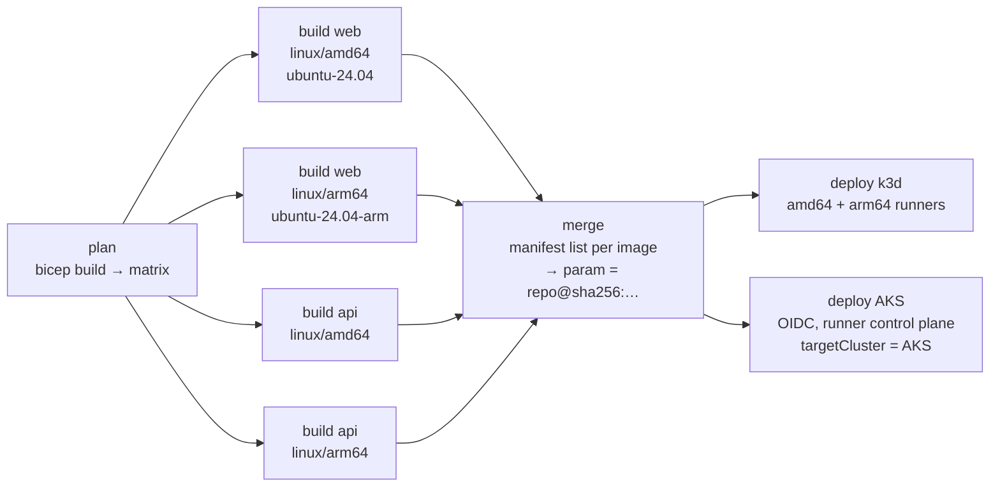

# radius-ci-build-poc

This proof of concept builds a Radius app's container images in GitHub Actions instead of inside Radius. It replaces `Radius.Compute/containerImages` (an in-cluster BuildKit build) with Bicep image parameters that CI fills in with digest references.

Background: running BuildKit inside Radius needs a PSA `privileged` namespace. See the [PSA discussion](https://gist.github.com/willdavsmith/7037b442885fae1cab64ff3f55bf5352).

## How it works

Each image the app builds is a `string` parameter in [`app.bicep`](app.bicep) with build metadata:

```bicep
@metadata({
  radius: {
    build: {
      context: 'api'            // required, relative to the repo root
      dockerfile: 'Dockerfile'  // optional, relative to context (default: Dockerfile)
      // platforms: ['linux/amd64']  // optional (default: workflow input)
      // name: 'api'                 // optional image name (default: param name minus "Image", kebab-cased)
    }
  }
})
param apiImage string
```

Bicep keeps parameter metadata in the compiled JSON (`parameters.apiImage.metadata.radius.build`), so CI reads the image list from the template itself. Adding a service means adding a parameter and a Dockerfile. The workflow doesn't change.



| Piece                                                                                 | What it does                                                                                                                                                                                            |
|---------------------------------------------------------------------------------------|---------------------------------------------------------------------------------------------------------------------------------------------------------------------------------------------------------|
| [`.github/actions/build-images/plan`](.github/actions/build-images/plan/action.yml)   | Installs a pinned Bicep CLI, compiles the template, and emits one matrix entry per image × platform, mapping each platform to a native runner.                                                          |
| [`.github/workflows/build-images.yml`](.github/workflows/build-images.yml)            | Reusable workflow (`workflow_call`): plan → build (`docker/build-push-action`, push by digest, GHA cache) → merge. Its output `parameters` maps each param to its digest reference.                     |
| [`.github/actions/build-images/merge`](.github/actions/build-images/merge/action.yml) | Creates a multi-arch manifest list per image (`docker buildx imagetools create`), tags it, and writes the `param → repo@sha256:…` map plus an ARM parameters file.                                      |
| [`.github/actions/setup-radius`](.github/actions/setup-radius/action.yml)             | Ephemeral k3d control plane on the runner, like ai-extensions `setup-control-plane`, **without** `dynamicrp.buildkit.enabled`. Optionally targets an external cluster (`global.targetCluster.enabled`). |
| [`.github/workflows/ci.yml`](.github/workflows/ci.yml)                                | Runs on PRs, on pushes to main and on dispatch. Builds, then deploys to k3d (amd64 and arm64 runners) and to AKS, and verifies that each deployment runs the exact CI-built digest.                     |
| [`.github/workflows/cleanup-pr.yml`](.github/workflows/cleanup-pr.yml)                | Deletes the PR's AKS namespace when the PR closes.                                                                                                                                                      |

Images are pushed to `ghcr.io/<owner>/<repo>/<name>` with `GITHUB_TOKEN` (`packages: write`). The tags are `pr-<n>` and `sha-<sha>` on PRs, and `sha-<sha>` and `main` on main. Deploys always use the digest, never a tag.

The verify step checks that every container in the app's Deployments runs one of the CI-built digests, that rollouts complete, and that the api reports the node's architecture.

## AKS setup

The `aks` GitHub Environment holds the same variables that ai-extensions `run-rad-commands-azure.yml` reads: `AZURE_CLIENT_ID`, `AZURE_TENANT_ID`, `AZURE_SUBSCRIPTION_ID`, `AZURE_RESOURCE_GROUP` and `AZURE_AKS_CLUSTER_NAME`. The identity is an Entra app with a federated credential for `environment:aks`, granted *Azure Kubernetes Service Cluster User Role* on the cluster. Each PR deploys into the `cibuild-pr-<n>` namespace, and main deploys into `cibuild-main`.

New repositories present an ID-qualified OIDC subject (`repo:<owner>@<owner-id>/<repo>@<repo-id>:environment:aks`), so the federated credential must match that form.

## What changes if adopted in ai-extensions

- `radius-app-bicep` skill: emit `param <svc>Image string` with `@metadata({ radius: { build: { context } } })` instead of `Radius.Compute/containerImages` + `radius-ghcr-registry-creds`.
- Generated workflows: call the build workflow before `rad deploy` and pass its `parameters` output (`run-rad-commands` already injects deploy parameters). The plan and merge actions move to `.github/extension/actions/build-images/` and are pinned with `{{RADIUS_REF}}`.
- `setup-control-plane`: drop `--set dynamicrp.buildkit.enabled=true`.
- The `containerImagesRegistry`/`containerImagesRegistrySecretName` recipe-pack wiring and the push-secret parameters are no longer needed.

## Limitations

- Pods pull without credentials: `Radius.Compute/containers` has no image pull secret support. Packages published from a public repo are public, so this works here. A private repo needs node-level registry credentials or pull secret support in the containers recipe.
- Native arm64 builds use `ubuntu-24.04-arm`, which is free for public repos. Private repos can set the `arm64-runner` input to `ubuntu-24.04` to build arm64 there under QEMU emulation (slower).
- The AKS cluster used here is amd64-only, so arm64 is exercised by the k3d arm64 job.
- The CI control plane installs Radius with `dashboard.enabled=false`, because `ghcr.io/radius-project/dashboard` is published for amd64 only and crash-loops on arm64 runners.
- Local `rad deploy` needs the image parameters supplied (for example from a prior CI run).
